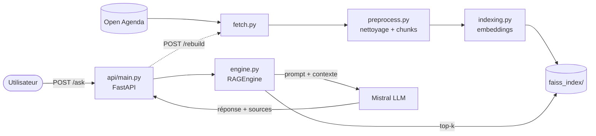

# Puls-Events : assistant RAG de recommandation d'événements culturels

LIEN GITHUB: https://github.com/TeoCourrege/Projet_9

POC d'un chatbot qui répond en langage naturel aux questions sur les événements culturels de **Toulouse**, en s'appuyant sur les données **Open Agenda** (1 an d'historique + événements à venir).

Le système est un **RAG** (*Retrieval-Augmented Generation*) :

1. **Recherche** : la question est vectorisée et comparée aux événements indexés dans **FAISS**.
2. **Augmentation** : les 5 événements les plus proches sont injectés dans le prompt.
3. **Génération** : le LLM **Mistral** rédige la réponse en s'appuyant uniquement sur ces événements.

Le tout est orchestré avec **LangChain** et exposé par une API **FastAPI**, conteneurisée avec **Docker**.

📄 Rapport technique : [docs/RAPPORT_TECHNIQUE.md](docs/RAPPORT_TECHNIQUE.md)

---

## Architecture



Diagrammes UML détaillés (composants, classes, séquence de `/ask`) : [rapport technique, § 2](docs/RAPPORT_TECHNIQUE.md#2-architecture-du-système).

## Structure du dépôt

```
├── puls_rag/               # Logique métier (indépendante de l'API)
│   ├── config.py           #   paramètres lus depuis .env
│   ├── fetch.py            #   collecte Open Agenda
│   ├── preprocess.py       #   nettoyage, filtres, chunking
│   ├── indexing.py         #   embeddings + index FAISS (flat / hnsw / ivf)
│   ├── pipeline.py         #   chaîne complète de (re)construction de l'index
│   ├── engine.py           #   RAGEngine : recherche + prompt + Mistral (LangChain)
│   └── evaluation.py       #   métriques (hit rate, F1, similarité, Ragas)
├── api/                    # API REST FastAPI (/ask, /search, /metadata, /rebuild, /health)
├── scripts/                # Points d'entrée en ligne de commande
│   ├── run_local.sh / .ps1 #   lance tout en local : venv, index, API
│   ├── deploy.sh / .ps1    #   déploiement Docker : image, index, service, healthcheck
│   ├── check_env.py        #   vérifie les imports et la configuration
│   ├── fetch_data.py       #   étape 1a : téléchargement
│   ├── preprocess.py       #   étape 1b : nettoyage + statistiques
│   ├── build_index.py      #   pipeline complet -> faiss_index/
│   ├── ask.py              #   chatbot en ligne de commande
│   ├── run_tests.py        #   tests + résumé lisible -> reports/tests/
│   ├── evaluate_rag.py     #   évaluation sur le jeu de test annoté
│   ├── compare_embeddings.py # E5 local vs mistral-embed
│   └── api_test.py         #   test fonctionnel de l'API lancée
├── tests/                  # Tests unitaires et d'intégration (pytest)
├── data/test_set.json      # Jeu de test annoté (16 questions / réponses de référence)
├── docs/                   # Rapport technique, référence de l'API, collection Postman
├── reports/                # Résultats des tests et de l'évaluation
├── Dockerfile, docker-compose.yml
├── requirements.txt        # dépendances d'exécution (versions figées)
├── requirements-dev.txt    # + tests et évaluation (pytest, ragas)
├── .env.example            # modèle du fichier .env
```

Ne sont **pas versionnés** (voir `.gitignore`) : `.venv/`, `.env`, `data/raw/`, `data/processed/`, `faiss_index/`. Ils sont recréés par les scripts.

---

## Prérequis

- **Python 3.11** (testé avec 3.11.14)
- **Docker Desktop**, pour la démo conteneurisée
- Une **clé API Mistral** : <https://console.mistral.ai/api-keys>. L'offre gratuite suffit pour le POC.
- Une connexion Internet pour la première installation : paquets, modèle d'embedding (~470 Mo) et données Open Agenda.

## Installation

### Windows (PowerShell)

```powershell
# 1. Environnement virtuel
py -3.11 -m venv .venv
.\.venv\Scripts\Activate.ps1
# Si l'activation est refusée : Set-ExecutionPolicy -Scope CurrentUser RemoteSigned

# 2. Dépendances (inclut les outils de test et d'évaluation)
python -m pip install --upgrade pip
pip install -r requirements-dev.txt

# 3. Configuration : copier le modèle puis renseigner MISTRAL_API_KEY et ADMIN_TOKEN
Copy-Item .env.example .env
notepad .env

# 4. Vérifier l'environnement
python scripts/check_env.py
```

### macOS / Linux

```bash
python3.11 -m venv .venv && source .venv/bin/activate
pip install -r requirements-dev.txt
cp .env.example .env   # puis éditer .env
python scripts/check_env.py
```

> Pour simuler une installation propre : supprimer `.venv/` et recommencer l'étape 1.

## Utilisation

### Démarrage rapide (une commande)

```powershell
.\scripts\run_local.ps1      # Windows : venv + dépendances + index si absent + API
.\scripts\deploy.ps1         # ou dans Docker : image + index + service + attente de /health
```

```bash
./scripts/run_local.sh       # macOS / Linux
./scripts/deploy.sh
```

L'option `-Rebuild` / `--rebuild` force le re-téléchargement et la reconstruction de l'index. Les sections suivantes détaillent chaque étape.

### 1. Construire la base vectorielle

```powershell
python scripts/build_index.py --refetch
```

Ce script télécharge les événements de Toulouse (~5 500 bruts), puis les nettoie : il retire les annulés, les doublons et les agendas non culturels, et garde ~4 000 événements. Il les découpe ensuite en chunks, les vectorise et écrit `faiss_index/`. Compter **5 à 10 minutes sur CPU** la première fois, téléchargement du modèle compris. Sans `--refetch`, le script réutilise `data/raw/`.

Options : `--index-type flat|hnsw|ivf`, `--city "Bordeaux"`.

Les étapes peuvent aussi être lancées séparément : `scripts/fetch_data.py`, puis `scripts/preprocess.py`, qui affiche des statistiques sur les données.

### 2. Poser des questions en ligne de commande

```powershell
python scripts/ask.py "Je cherche un concert de rap en décembre"
python scripts/ask.py          # mode interactif
```

### 3. Lancer l'API

```powershell
uvicorn api.main:app --port 8000
```

- Documentation interactive (Swagger) : <http://localhost:8000/docs>
- Test fonctionnel complet (dans un 2e terminal) : `python scripts/api_test.py`

| Méthode | Route | Rôle |
|---|---|---|
| `POST` | `/ask` | `{"question": "...", "k": 5}` → réponse générée, `found`, événements sources |
| `POST` | `/search` | Recherche FAISS seule, sans LLM, paginée (`k`, `offset`). Utile en secours si l'API Mistral est indisponible |
| `GET` | `/metadata` | Périmètre (ville, période), modèles, paramètres, taille et date de l'index |
| `POST` | `/rebuild` | Reconstruit l'index (`{"refetch": true}` pour re-télécharger). En-tête `X-Admin-Token` requis |
| `GET` | `/health` | État : index chargé, nombre de vecteurs, LLM configuré |

Référence complète (paramètres, réponses, erreurs, exemples Python) : [docs/API.md](docs/API.md). Collection Postman : [docs/postman_collection.json](docs/postman_collection.json).

Exemple PowerShell :

```powershell
Invoke-RestMethod -Method Post -Uri http://localhost:8000/ask `
  -ContentType "application/json; charset=utf-8" `
  -Body '{"question": "Y a-t-il une soirée techno gratuite début décembre ?"}'
```

Exemple bash : `curl -X POST localhost:8000/ask -H "Content-Type: application/json" -d '{"question": "Un concert de jazz ?"}'`

Codes d'erreur : `422` question vide ou invalide · `401/403` jeton admin absent ou invalide · `503` index non construit ou clé Mistral absente · `502` erreur côté Mistral.

### 4. Démo avec Docker

```powershell
# Construire l'image (~5 min la 1re fois ; le modèle d'embedding est intégré à l'image)
docker compose build

# Construire l'index DANS le conteneur : pas besoin de Python sur la machine
docker compose run --rm api python scripts/build_index.py --refetch

# Lancer l'API (la clé est lue dans .env au démarrage, jamais copiée dans l'image)
docker compose up -d
python scripts/api_test.py      # ou http://localhost:8000/docs
docker compose logs -f api      # logs
docker compose down             # arrêt
```

`faiss_index/` et `data/` sont montés en volumes : un index construit sur la machine hôte avec `scripts/build_index.py` est utilisé directement par le conteneur, et un `POST /rebuild` persiste après redémarrage.

Sans docker compose :

```powershell
docker build -t puls-events-rag .
docker run -p 8000:8000 --env-file .env -v ${PWD}/faiss_index:/app/faiss_index -v ${PWD}/data:/app/data puls-events-rag
```

### 5. Tests

```powershell
python scripts/run_tests.py   # tous les tests + résumé lisible dans reports/tests/summary.md
pytest                        # équivalent brut : unitaires hors ligne, sans clé (~2 s)
pytest -m integration         # seulement les tests sur les vraies données (après build_index.py)
```

Les tests d'intégration sont ignorés tant que `faiss_index/` n'existe pas. Dernier résultat : [reports/tests/summary.md](reports/tests/summary.md).

Les tests unitaires couvrent la collecte (API simulée), le nettoyage et les filtres (ville, période, doublons, HTML, données manquantes), le chunking, l'indexation (tous les chunks indexés, persistance, types d'index, temps de recherche), le moteur RAG (prompt envoyé, déduplication, erreurs), l'API (codes HTTP, validation, sécurité de `/rebuild`) et les métriques d'évaluation.

### 6. Évaluation

```powershell
python scripts/evaluate_rag.py --retrieval-only   # recherche seule, sans clé Mistral
python scripts/evaluate_rag.py --no-ragas         # + qualité des réponses vs références
python scripts/evaluate_rag.py                    # + métriques Ragas (Mistral comme juge)
```

Résultats : `reports/eval_summary.json` (moyennes), `reports/eval_results.csv` (détail par question) et `reports/eval_errors.md` (analyse des erreurs : recherches manquées, réponses incorrectes, hallucinations probables). Le détail des métriques figure dans le rapport technique.

Comparaison des modèles d'embedding (E5 local vs `mistral-embed`) sur la recherche :

```powershell
python scripts/compare_embeddings.py   # -> reports/embeddings_comparison.json
```

> Le jeu de test vise des événements de novembre 2026 à février 2027. Au-delà de février 2028, ils sortiront de la fenêtre d'un an et le jeu devra être mis à jour.

---

## Configuration (.env)

| Variable | Défaut | Rôle |
|---|---|---|
| `MISTRAL_API_KEY` | — | Clé API Mistral (obligatoire pour `/ask` et Ragas) |
| `ADMIN_TOKEN` | — | Jeton de `/rebuild` (vide = route désactivée) |
| `OA_CITY` | `Toulouse` | Ville ciblée |
| `OA_HISTORY_DAYS` | `365` | Historique conservé (jours) |
| `LLM_MODEL` | `mistral-small-latest` | Modèle de génération |
| `LLM_TEMPERATURE` | `0.1` | Créativité du LLM (bas = factuel) |
| `TOP_K` | `5` | Événements injectés dans le prompt |
| `MIN_SCORE` | `0` | Similarité minimale d'un événement. En dessous : `found: false`, sans appel LLM (0 = désactivé) |
| `EMBEDDING_PROVIDER` | `huggingface` | `huggingface` (local) ou `mistral` (`mistral-embed`) |
| `EMBEDDING_MODEL` | `intfloat/multilingual-e5-small` | Modèle d'embedding |
| `INDEX_TYPE` | `flat` | `flat` (exact), `hnsw` ou `ivf` (approximatifs) |
| `CHUNK_SIZE` / `CHUNK_OVERLAP` | `800` / `150` | Découpage des descriptions (caractères) |

Changer de modèle d'embedding ou de ville impose de reconstruire l'index.

## Dépannage

- **`503 Index FAISS non chargé`** : lancer `scripts/build_index.py`, ou `POST /rebuild`.
- **`503 MISTRAL_API_KEY absente`** : renseigner `.env`, puis redémarrer l'API ou le conteneur.
- **`502` / erreurs 429 pendant l'évaluation** : quota de l'offre gratuite Mistral. Augmenter `--pause` ou relancer.
- **Imports de l'énoncé** : LangChain 1.x et mistralai 3.x ont déplacé leurs modules. `from langchain.vectorstores import FAISS` devient `from langchain_community.vectorstores import FAISS`, et `from mistral import MistralClient` devient `from mistralai.client import Mistral` (voir `scripts/check_env.py`).