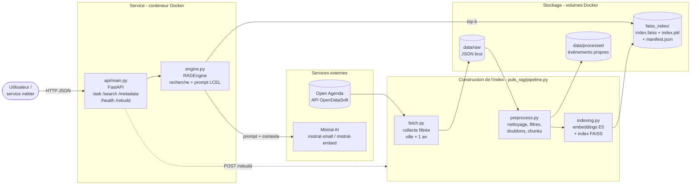
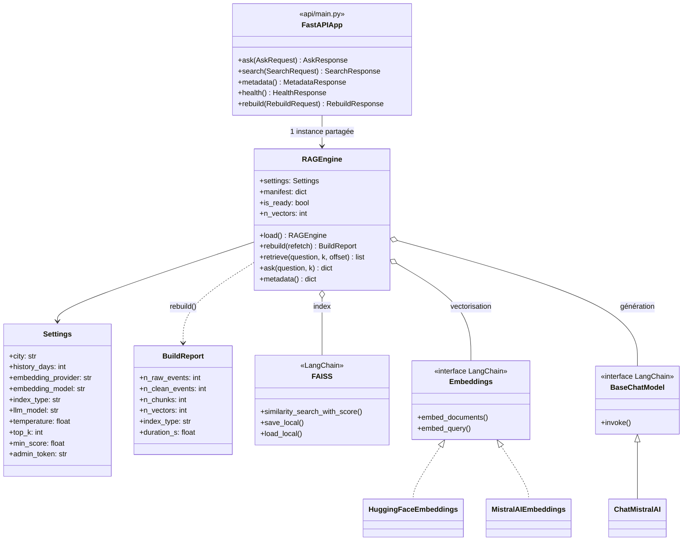
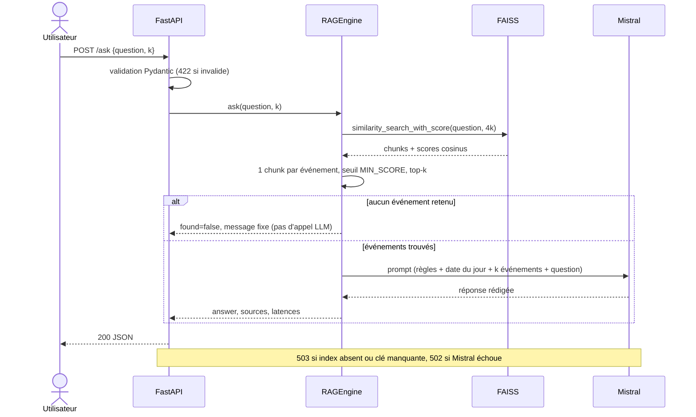

# Rapport technique : POC RAG Puls-Events

**Projet :** assistant intelligent de recommandation d'événements culturels
**Client :** Puls-Events (responsable technique : Jérémy)
**Version :** 1.0 · octobre 2026

---

## 1. Objectifs du projet

### Contexte
Puls-Events développe une plateforme de recommandations culturelles personnalisées. L'entreprise veut savoir si un chatbot peut répondre aux questions des utilisateurs sur les événements culturels (« Quels concerts de rap en décembre ? », « Une activité au musée pour mon bébé ? ») à partir des données publiques **Open Agenda**.

### Problématique
Un LLM seul ne connaît ni l'agenda culturel local ni les événements récents : ses connaissances s'arrêtent à sa date d'entraînement, et il invente des réponses plausibles mais fausses (hallucinations). Une recherche par mots-clés, elle, renvoie une liste de résultats bruts, pas une réponse.

### Objectif du POC
Démontrer la **faisabilité technique** d'un système RAG, combinant recherche sémantique et génération, puis mesurer sa **pertinence** et sa **performance** :
- une base vectorielle FAISS reconstructible à partir d'Open Agenda ;
- une chaîne LangChain + Mistral qui répond en français à partir des seuls événements retrouvés ;
- une API REST conteneurisée, utilisable par les équipes produit et marketing ;
- un jeu de test annoté et des métriques automatisées.

### Périmètre
- **Zone :** Toulouse, choisie pour son volume d'événements (~5 500 sur la période) et sa diversité de lieux (musées, salles de concert, médiathèques, théâtres).
- **Période :** événements terminés depuis moins d'un an, et tous les événements à venir.
- **Hors périmètre :** historique de conversation, personnalisation par profil utilisateur, authentification des utilisateurs finaux.

---

## 2. Architecture du système

### Diagramme de composants (UML)

Deux flux partagent la base vectorielle : la **construction de l'index** (hors ligne, ou via `/rebuild`) et la **réponse aux questions** (en ligne).



### Diagramme de classes (UML)



Les dépendances `FAISS`, `Embeddings` et `BaseChatModel` sont injectées dans le constructeur de `RAGEngine`. Les tests y substituent un embedding déterministe et un LLM factice.

### Diagramme de séquence : `POST /ask`



| Brique | Rôle | Fichier |
|---|---|---|
| Collecte | Téléchargement filtré (ville, période) | `puls_rag/fetch.py` |
| Prétraitement | Nettoyage HTML, filtres, déduplication, chunks + métadonnées | `puls_rag/preprocess.py` |
| Indexation | Vectorisation, index FAISS, persistance, manifeste | `puls_rag/indexing.py`, `pipeline.py` |
| Moteur RAG | Recherche, prompt, appel Mistral (LCEL) | `puls_rag/engine.py` |
| API | `/ask`, `/search`, `/metadata`, `/rebuild`, `/health` + Swagger | `api/main.py`, `api/schemas.py` |
| Évaluation | Jeu annoté, métriques, Ragas, analyse des erreurs, comparaison des embeddings | `puls_rag/evaluation.py`, `scripts/evaluate_rag.py`, `scripts/compare_embeddings.py` |
| Tests | Tests unitaires et d'intégration, résumé lisible | `tests/`, `scripts/run_tests.py` |
| Déploiement | Image Docker, volumes pour l'index, scripts de lancement | `Dockerfile`, `docker-compose.yml`, `scripts/deploy.*`, `scripts/run_local.*` |

**Principe de conception :** la logique métier (`puls_rag/`) est indépendante de l'API. La classe `RAGEngine` est le point d'entrée unique, partagé par l'API, les scripts et les tests. Ses dépendances (embeddings, index, LLM) sont injectables, ce qui permet des tests unitaires hors ligne.

---

## 3. Données

### Source
Jeu de données public **`evenements-publics-openagenda`**, publié par Open Agenda sur OpenDataSoft. Il agrège tous les agendas publics d'Open Agenda. Ce choix évite l'API v2, qui impose une clé et une interrogation agenda par agenda. Le filtrage (ville + date de fin) est fait côté serveur en ODSQL, et l'endpoint d'export renvoie tous les résultats en un appel, sans pagination.

Filtre appliqué : `location_city="Toulouse" AND lastdate_end >= date'<aujourd'hui - 365 j>'`.

### Nettoyage

| Étape | Traitement | Volume indicatif* |
|---|---|---|
| Collecte | Événements bruts | ~5 470 |
| Validité | Exclusion des événements sans identifiant ni titre | |
| Filtres de contrôle | Ville = Toulouse, fin < 1 an (revérifiés côté client) | |
| Statut | Exclusion des événements « Annulé » | −38 |
| Périmètre culturel | Exclusion des agendas emploi, industrie, rénovation, séminaires scientifiques (France Travail, Semaine de l'industrie…) | ~−1 300 |
| Doublons | Même `uid` (version la plus récente gardée), ou même titre + lieu + date | |
| Données manquantes | Description longue absente : remplacée par le résumé, sinon par le titre | ~390 concernés |
| **Résultat** | **Événements culturels indexés** | **~4 000** |

\* Mesuré sur un export d'octobre 2026 : `scripts/preprocess.py` affiche les chiffres exacts à chaque exécution.

Le HTML des descriptions est supprimé avec BeautifulSoup, en conservant les retours à la ligne. Les champs JSON encodés (statut, mode de participation) sont décodés, et les dates converties au fuseau Europe/Paris.

Le filtre culturel est une liste d'agendas exclus, visible dans `EXCLUDED_AGENDA_PATTERNS`. Avant ce filtre, les mots-clés les plus fréquents étaient « recrutement » et « marché du travail ». Après, ce sont « rencontre », « atelier », « drame », « musée » et « cinéma ».

### Chunking
Chaque événement devient un ou plusieurs chunks de la forme **en-tête structuré + morceau de description** :

```
Titre : Psykup
Dates : du 12/12/2026 au 12/12/2026 (Samedi 12 décembre, 20h00)
Lieu : Le Metronum / Scène de musiques actuelles de Toulouse, 2 Rond-Point Madame de Mondonville...
Mots-clés : metal
Tarif / conditions : À partir de 25.5 €
Description : Psykup célèbrera ses 30 ans d'existence...
```

- **Stratégie :** découpage récursif avec chevauchement (`RecursiveCharacterTextSplitter`, 800 caractères, 150 de recouvrement). Il coupe de préférence aux paragraphes, puis aux phrases.
- **Pourquoi répéter l'en-tête :** chaque chunk reste autoporteur. Un fragment de description retrouvé seul garde son titre, ses dates, son lieu et son tarif, à la fois pour l'embedding et pour le LLM.
- **Taille :** la médiane des descriptions est d'environ 500 caractères, donc la plupart des événements tiennent en un seul chunk (~5 900 chunks pour ~4 000 événements). Avec l'en-tête, un chunk reste sous la limite de 512 tokens du modèle d'embedding.
- **Métadonnées stockées** avec chaque vecteur : `uid`, titre, dates (ISO et lisibles), lieu, adresse, ville, mots-clés, tarif, URL Open Agenda, numéro de chunk.

---

## 4. Choix technologiques et modèles

### Embeddings : `intfloat/multilingual-e5-small` (local, HuggingFace)
| Critère | Choix |
|---|---|
| Langue | Les données sont en français. `all-MiniLM-L6-v2`, suggéré dans le guide, est entraîné surtout sur l'anglais |
| Qualité | E5 est entraîné pour la recherche question → passage, avec des préfixes `query:` et `passage:` |
| Contexte | 512 tokens, contre 128 pour `paraphrase-multilingual-MiniLM` |
| Coût | 118 M de paramètres, dimension 384, exécution sur CPU, gratuit, sans appel réseau à l'usage |

**Alternative Mistral intégrée :** `EMBEDDING_PROVIDER=mistral` vectorise les descriptions avec `mistral-embed` (dimension 1024), via `MistralAIEmbeddings` de LangChain. Le reste de la chaîne ne change pas. Cette option est plus simple à déployer, mais demande un appel API par requête et par document, ce qui ajoute du coût, de la latence et une dépendance réseau.

**Comparaison mesurée :** `scripts/compare_embeddings.py` vectorise les mêmes chunks avec les deux modèles, construit un index par modèle et mesure hit rate@k, MRR, temps d'indexation et latence de recherche sur le jeu annoté (`reports/embeddings_comparison.json`). Le modèle par défaut se choisit sur ces chiffres.

| Modèle | Dimension | Hit rate@5 | MRR | Indexation (s) | Recherche (ms) |
|---|---|---|---|---|---|
| `intfloat/multilingual-e5-small` | 384 | | | | |
| `mistral-embed` | 1024 | | | | |

> À compléter après `python scripts/compare_embeddings.py`, qui demande l'accès à l'API Mistral et à HuggingFace.

### Index FAISS
- **Métrique :** produit scalaire sur vecteurs normalisés, ce qui revient à la **similarité cosinus** (score entre −1 et 1, renvoyé dans les sources).
- **Algorithme par défaut : `IndexFlatIP`**, une recherche exacte. Avec ~6 000 vecteurs de dimension 384 (~9 Mo), parcourir tous les vecteurs prend moins d'une milliseconde : une approximation n'apporterait rien et coûterait en précision.
- **Alternatives configurables** (`INDEX_TYPE`) pour un passage à l'échelle (France entière : plusieurs millions d'événements) :
  - `hnsw` (`IndexHNSWFlat`, M=32, efSearch=64) : graphe de proximité, très rapide, sans entraînement ;
  - `ivf` (`IndexIVFFlat`, nlist ≈ √n, nprobe=16) : partitionnement par k-means, mémoire maîtrisée.
- **Persistance :** `index.faiss` (vecteurs) + `index.pkl` (docstore : textes et métadonnées) + `manifest.json` (paramètres de construction, volumes, date).
- **Contrôle d'intégrité au build :** nombre de vecteurs égal au nombre de chunks, et chaque événement possède au moins un chunk. Sinon, le build échoue.

### Recherche : déduplication par événement
Le moteur récupère 4×k chunks puis ne garde que **le meilleur chunk par événement**, jusqu'à k événements. Sans cette étape, un événement à longue description pourrait occuper plusieurs places du top-k et réduire la diversité des recommandations.

### LLM : `mistral-small-latest` (API Mistral)
- Bon compromis qualité / coût / latence pour une génération courte en français. `mistral-large` reste une option si la qualité de rédaction devient prioritaire.
- **Température 0,1 :** réponses quasi déterministes et fidèles au contexte, sans créativité qui inventerait des détails.

### Orchestration : LangChain (LCEL)
La chaîne est composée en LCEL : `ChatPromptTemplate | ChatMistralAI | StrOutputParser`. La recherche est faite explicitement avant l'appel. `RetrievalQA`, cité dans le guide, est déprécié depuis LangChain 0.2 et absent du cœur de LangChain 1.x. LCEL est son remplaçant : il produit le même comportement (*stuff* : tous les chunks dans un seul prompt) et laisse la main sur la déduplication, les scores et les mesures de latence.

### Prompt
Le message système fixe le comportement :
- répondre **uniquement** à partir des événements fournis, sans inventer de date, de lieu ni de tarif ;
- le dire clairement si rien ne correspond ;
- tenir compte de **la date du jour**, injectée à chaque requête. Sans elle, le LLM ne peut pas interpréter « ce week-end » ni signaler un événement passé ;
- répondre en français, de façon concise, avec titre, dates, lieu et tarif pour chaque recommandation.

### API : FastAPI
- Validation automatique par Pydantic (question non vide, 1 000 caractères au plus, `k` entre 1 et 20) et documentation Swagger sur `/docs`.
- **Chargement unique** de l'index et du modèle d'embedding au démarrage (`lifespan`). Une requête ne fait ensuite que la recherche et l'appel Mistral.
- **`/rebuild` protégé** par l'en-tête `X-Admin-Token`, comparé en temps constant, et désactivé si `ADMIN_TOKEN` est vide. Le nouvel index remplace l'ancien à chaud, sous verrou : les requêtes en cours continuent sur l'ancien.
- Codes d'erreur explicites : 422 (entrée invalide), 401/403 (jeton), 503 (index ou clé absents), 502 (erreur Mistral). L'API démarre même sans index, pour permettre un `/rebuild`.
- **`/search`** : recherche seule, sans LLM. C'est un plan de secours pour la démo si l'API Mistral est indisponible. Elle est **paginée** (`k` = taille de page, `offset`, `next_offset` dans la réponse). `/ask` n'est pas paginée : le LLM rédige une seule réponse à partir d'au plus 20 événements.
- **`/metadata`** : décrit le périmètre (ville, période, source), les modèles, les paramètres de recherche et l'index (nombre d'événements, date de construction). Un service consommateur sait ainsi ce que couvrent les réponses.
- **Cas « pas de réponse »** : si aucun événement ne dépasse le seuil `MIN_SCORE`, `/ask` renvoie `found: false` et un message fixe, sans appeler le LLM, ce qui supprime tout risque d'invention. Le seuil est désactivé par défaut (0) : les scores E5 restent élevés même pour des textes peu liés, donc il faut le calibrer sur les scores observés avec `/search` (voir `reports/eval_results.csv`). Les questions hors périmètre du jeu de test servent à vérifier ce comportement.
- Référence complète des endpoints : [`docs/API.md`](API.md), et collection Postman : [`docs/postman_collection.json`](postman_collection.json).

### Conteneurisation : Docker
- Déploiement en une commande : `scripts/deploy.sh` / `scripts/deploy.ps1`. Le script construit l'image, construit l'index dans le conteneur s'il est absent, démarre le service et attend `/health`. Sans Docker : `scripts/run_local.sh` / `scripts/run_local.ps1`.
- Image `python:3.11-slim` avec PyTorch **CPU** (plusieurs Go économisés par rapport à la version CUDA).
- Modèle d'embedding **téléchargé au build** : le conteneur démarre sans accès à HuggingFace.
- Index et données **montés en volumes** : l'image ne change pas quand l'index est reconstruit.
- Clé Mistral injectée au démarrage (`env_file`), jamais présente dans l'image. Utilisateur non-root et `HEALTHCHECK` sur `/health`.

### Sécurité
`.env` est ignoré par Git et par Docker, un modèle `.env.example` est fourni, et aucune clé n'apparaît dans le code ni dans les logs. La désérialisation pickle de l'index n'est autorisée que pour l'index produit par notre propre script.

---

## 5. Évaluation

### Jeu de test annoté (`data/test_set.json`)
16 questions rédigées à partir d'événements réels, chacune avec une réponse de référence et le ou les identifiants des événements attendus :
- 7 questions **factuelles** (« Quand joue Psykup et à quel prix ? ») ;
- 7 **recommandations** formulées sans le nom de l'événement (« un concert country ou folk », « une activité au musée pour les bébés ») ;
- 2 questions **hors périmètre** (événements à Lyon, météo), pour vérifier que le système reconnaît qu'il ne sait pas.

### Métriques (`scripts/evaluate_rag.py`)

| Niveau | Métrique | Mesure |
|---|---|---|
| Recherche | **Hit rate@k** | Part des questions où l'événement attendu figure dans les k sources |
| Recherche | **MRR** | 1 / rang du premier événement attendu (1 = en tête) |
| Réponse | Exact match | Égalité stricte après normalisation. Quasi nulle par construction pour du texte libre, indiquée pour mémoire |
| Réponse | F1 lexical | Recouvrement de mots avec la référence |
| Réponse | **Similarité sémantique** | Cosinus entre les embeddings de la réponse et de la référence |
| Réponse | Verdict | correcte (≥ 0,88) / partiellement correcte (≥ 0,80) / incorrecte, à partir de la similarité |
| Ragas | **Faithfulness** | Part des affirmations de la réponse soutenues par le contexte (anti-hallucination) |
| Ragas | Answer relevancy | La réponse traite-t-elle la question posée ? |
| Ragas | Context precision | Les événements récupérés sont-ils pertinents, et bien classés ? |
| Ragas | Context recall | Le contexte contient-il les informations de la référence ? |

Ragas utilise Mistral comme LLM juge et le même modèle E5 pour les embeddings.

### Résultats

> **À compléter après exécution** sur une machine ayant accès à Open Agenda, HuggingFace et Mistral : `python scripts/build_index.py --refetch`, puis `python scripts/evaluate_rag.py`. Reporter ensuite les valeurs de `reports/eval_summary.json`, et l'analyse de `reports/eval_errors.md` dans la section *Erreurs observées* ci-dessous.

| Métrique | Valeur | Commentaire |
|---|---|---|
| Hit rate@5 | | |
| MRR | | |
| Similarité sémantique moyenne | | |
| Verdicts (correcte / partielle / incorrecte) | | |
| Faithfulness | | |
| Answer relevancy | | |
| Context precision | | |
| Context recall | | |
| Latence moyenne `/ask` | | dont recherche : quelques dizaines de ms |

**Grille de lecture :**
- hit rate faible : problème de recherche (embeddings, chunking, k) ;
- hit rate bon mais faithfulness faible : le LLM s'écarte du contexte, à corriger dans le prompt ;
- faithfulness < 0,7 : hallucinations fréquentes, à analyser question par question dans `eval_results.csv`.

### Erreurs observées

`scripts/evaluate_rag.py` produit `reports/eval_errors.md`. Ce fichier liste les questions dont l'événement attendu n'a pas été retrouvé (avec les événements retrouvés à la place), les réponses classées incorrectes et celles dont la faithfulness est inférieure à 0,7, avec un décompte par catégorie.

| Type d'erreur | Questions concernées | Cause identifiée | Limite associée (§ 6) |
|---|---|---|---|
| Recherche manquée | | | |
| Réponse incorrecte | | | |
| Hallucination (faithfulness < 0,7) | | | |

> À compléter à partir de `reports/eval_errors.md`. Erreurs attendues d'après la conception : les questions temporelles (« en décembre ») et les noms propres rares, peu captés par la recherche sémantique.

### Tests automatisés

`python scripts/run_tests.py` lance la suite et écrit `reports/tests/summary.md` (résumé par module), `reports/tests/junit.xml` et, si `pytest-cov` est installé, `reports/tests/coverage.txt`. La CI GitHub Actions publie ces fichiers comme artefact à chaque push.

**Résultats du 27/10/2026 (Python 3.11.14) : 92 passés, 0 échec, 5 ignorés, en moins de 2 s.**

| Module | Périmètre | Tests |
|---|---|---|
| `test_data_pipeline` | Collecte simulée, filtres de ville, de période et de statut, doublons, HTML, données manquantes, chunking (taille maximale, métadonnées, en-tête) | 21 |
| `test_indexing` | Tous les chunks indexés, persistance et rechargement, trois types d'index, temps de recherche < 50 ms | 16 |
| `test_engine` | Contenu exact du prompt, déduplication, pagination, seuil de score, cas sans résultat sans appel LLM, erreurs | 16 |
| `test_api` | Codes HTTP, validation, pagination de `/search`, `/metadata`, `found`, sécurité de `/rebuild`, Swagger | 24 |
| `test_evaluation` | Validité du jeu annoté, métriques, rapport d'erreurs | 15 |
| `test_real_index` | **Intégration** sur les vraies données : volume collecté, filtres respectés, chaque événement indexé, pertinence d'une recherche, latence < 500 ms | 5 (ignorés sans index) |

Les tests unitaires s'exécutent hors ligne et sans clé : embedding déterministe et LLM factice. Les tests d'intégration s'exécutent automatiquement dès que `faiss_index/` existe.

**CI GitHub Actions** : tests et couverture à chaque push. L'évaluation complète se déclenche manuellement : elle construit l'index, lance l'évaluation et échoue si le hit rate passe sous 0,7.

---

## 6. Limites observées

1. **Questions temporelles.** La recherche vectorielle capte mal « ce week-end » ou « en décembre » : la date est dans le texte des chunks, mais une similarité sémantique ne fait pas de comparaison de dates. Le LLM connaît la date du jour et peut écarter un événement passé, mais seulement parmi les k événements récupérés.
2. **Questions d'agrégation** (« combien de concerts en décembre ? », « tous les événements gratuits ») : un top-5 ne permet pas de répondre de façon exhaustive.
3. **Événements récurrents.** Une même visite guidée publiée à des dizaines de dates crée des quasi-doublons, qui peuvent occuper tout le top-k.
4. **Filtre culturel par liste d'agendas** : simple et efficace, mais à maintenir à la main. Des événements non culturels isolés peuvent passer.
5. **Dépendance à l'API Mistral** pour la génération (quota, latence réseau, disponibilité).
6. **Jeu de test limité** à 16 questions, rédigé par une seule personne : utile pour comparer des versions, pas pour une mesure statistiquement robuste.

## 7. Pistes d'amélioration

| Priorité | Amélioration | Effet attendu |
|---|---|---|
| 1 | **Filtrage par métadonnées avant la recherche** : extraire les dates, le prix ou le public de la question (via le LLM ou des règles), puis filtrer FAISS sur `first_begin`, `last_end` et `conditions` | Corrige la limite principale (questions temporelles) |
| 2 | **Recherche hybride** BM25 + vecteurs, avec fusion des rangs (RRF) | Meilleurs résultats sur les noms propres (artistes, lieux) |
| 3 | **Reranking** du top-20 par un cross-encoder (ou `mistral-rerank`), puis top-5 | Meilleure précision du contexte |
| 4 | Regrouper les occurrences d'un même événement récurrent (titre + lieu) | Recommandations plus diverses |
| 5 | Classification automatique culturel / non culturel (mots-clés + LLM) | Remplace la liste d'agendas maintenue à la main |
| 6 | Mise à jour incrémentale de l'index (ajout et suppression par `uid`) planifiée chaque nuit | Données fraîches sans reconstruction complète |
| 7 | Historique de conversation et streaming de la réponse | Expérience de chatbot plus naturelle |
| 8 | Élargir le jeu de test (50 à 100 questions, annotées par l'équipe produit) et suivre les métriques à chaque version | Mesure fiable, détection des régressions |
| 9 | Passage à l'échelle nationale : index `hnsw`/`ivf`, base vectorielle managée (Qdrant, pgvector), cache des réponses fréquentes | Volume × 100 |
| 10 | Production : authentification de l'API, limitation de débit, observabilité (LangSmith, logs structurés), alertes de coût | Industrialisation |

---

## Annexe : reproduire les résultats

```powershell
pip install -r requirements-dev.txt
Copy-Item .env.example .env         # renseigner MISTRAL_API_KEY
python scripts/build_index.py --refetch
python scripts/run_tests.py          # tests unitaires + intégration -> reports/tests/
python scripts/evaluate_rag.py       # -> reports/eval_*.{json,csv,md}
python scripts/compare_embeddings.py # -> reports/embeddings_comparison.json
```
